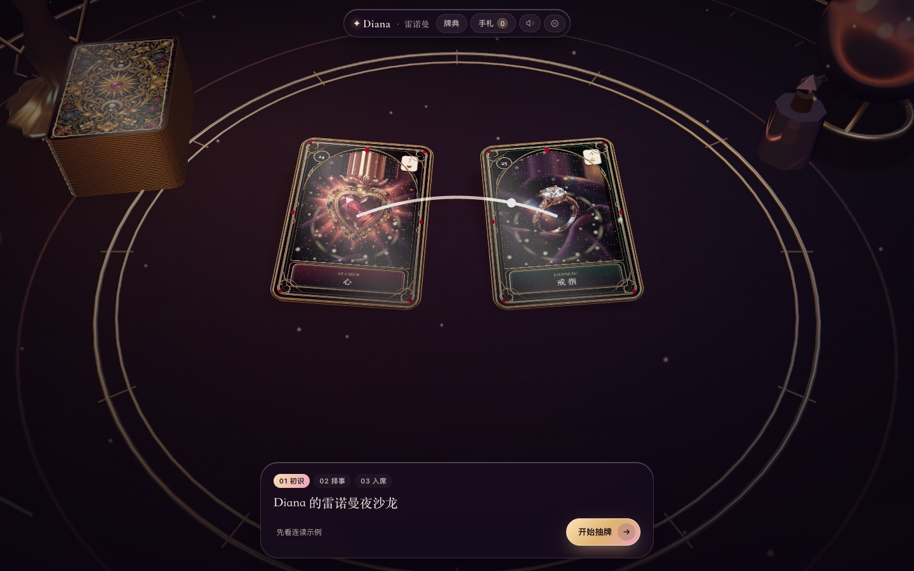
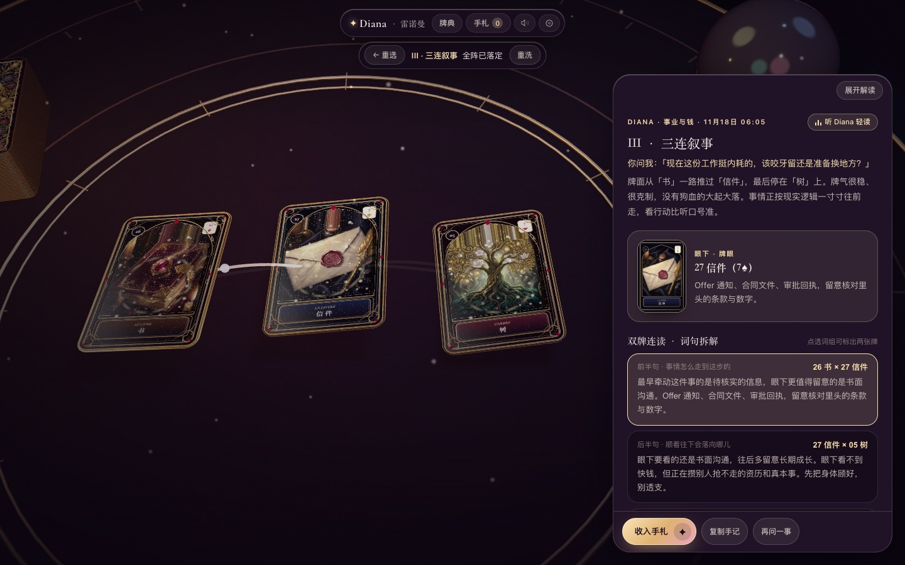
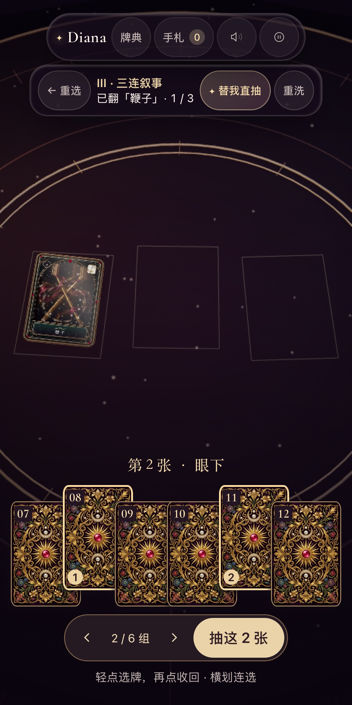
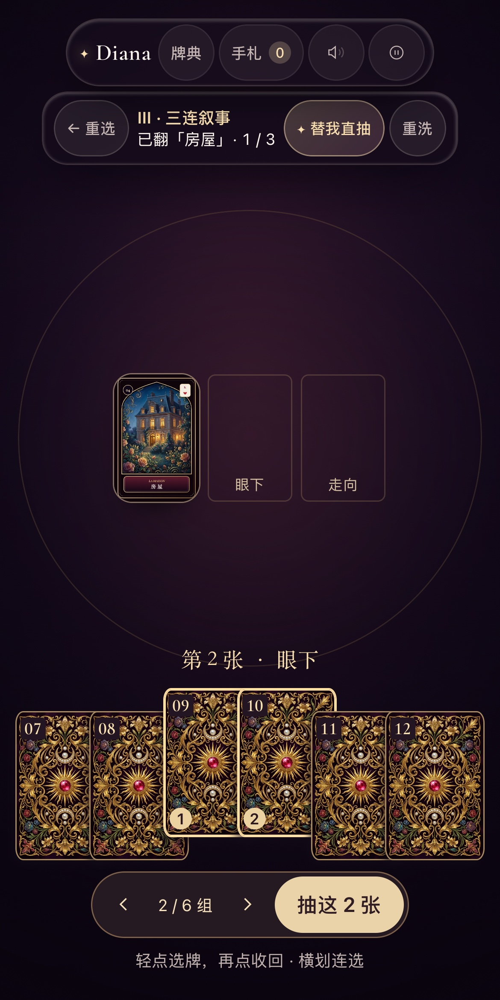
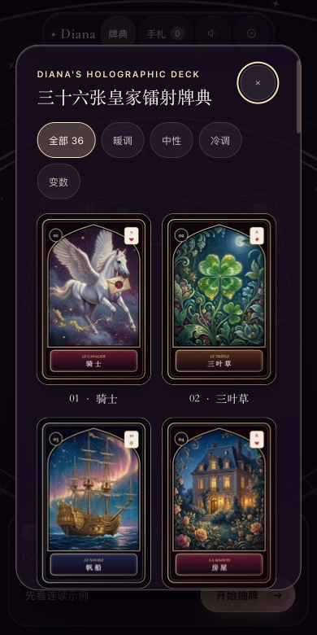

# Diana · 雷诺曼夜沙龙

Salon de Lenormand 是一个可在浏览器里运行的雷诺曼牌桌。全套 36 张牌支持四种牌阵、双牌连读、单牌详览和本机手札。能使用 WebGL 时显示三维牌桌，其余环境可在平面牌桌完成全程。

[体验网页版](https://salon-lenormand.pages.dev/)

## 界面截图

### 桌面牌桌



### 三牌连读



### 手机选牌

每组六张。轻点抬牌，再点收回，也可以横划连选。抬起牌上的小圆标是入阵顺序，确认后按这个顺序翻开。



### 手机平面牌桌



### 手机版牌典



## 本地运行

克隆仓库或解压 ZIP 后，在项目根目录启动静态服务。

```sh
python3 -m http.server 8768 --bind 127.0.0.1
```

在浏览器打开 [http://127.0.0.1:8768/](http://127.0.0.1:8768/)。运行所需的 Three.js、字体、模型和牌图都随项目附带。手札存在当前浏览器，可从手札面板导出 JSON。

## 开发

- `index.html`、`styles.css`、`js/` 包含页面、互动、三维与平面牌桌和解读引擎。
- `assets/cards/` 存放原始牌图，`assets/deck/` 存放单张牌面和运行时图集，`assets/models/` 存放 GLB 模型。
- `scripts/` 包含牌面生成脚本和 Blender 卡牌模型脚本。资源更新与部署步骤见 [交接文档](HANDOFF.md)。

## 许可

项目原创代码、文档及素材采用 [MIT 许可证](LICENSE)。随附的 [Three.js](vendor/three-0.170.0/LICENSE) 采用上游 MIT 许可证，[Cormorant Garamond 字体](assets/fonts/OFL.txt) 采用 SIL Open Font License 1.1。
